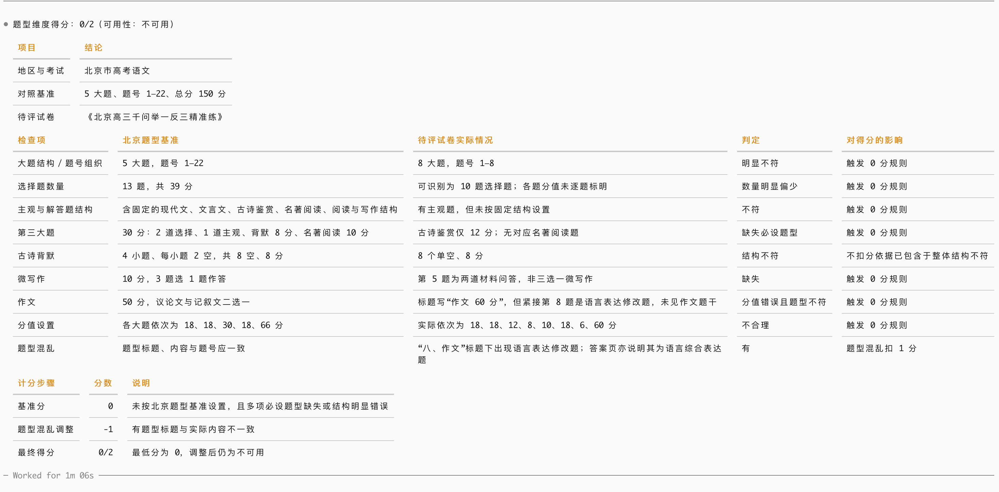

# 语文试卷题型评分

`chinese-exam-format-scoring` 是一个用于评估语文升学考试试卷**题型维度**的 Codex Skill。它依据指定地区的题型基准，对试卷的结构、题量、分值与题型组织进行严格评分。

## 能做什么

- 按地区题型基准核验必设选择题、主观／解答题及地区特定题型；
- 检查题号与大题结构、题目数量和分值设置；
- 识别题型归类、标签、排序或归属的混乱；
- 输出 `0`、`1` 或 `2` 分，并以可核验的中文表格说明每一项判定。

评分结果含义如下：

| 得分 | 可用性 | 含义 |
| ---: | --- | --- |
| 0/2 | 不可用 | 未按必设题型设置，或题型结构明显不合理 |
| 1/2 | 有缺陷 | 题量略有偏差，或分值设置错误／不合理 |
| 2/2 | 无问题 | 题型结构、数量与分值均符合基准 |

若题型组织混乱，会在上述基准分上额外扣 1 分，最低为 0 分。

## 使用方式

在对话中提供待评试卷，并明确考试地区和考试类型。例如：

```text
使用 $chinese-exam-format-scoring，依据北京市高考语文题型基准，
为下面这份试卷的题型维度评分：
（粘贴或上传试卷内容）
```

Skill 会先读取对应地区的基准文件，再按统一表格给出地区与考试信息、逐项对照证据，以及最终的计分步骤。它只评估题型维度，不评价试题内容、语言质量、答案质量或排版。

## 当前题型基准

| 地区与考试 | 基准文件 | 状态 |
| --- | --- | --- |
| 北京市高考语文 | [references/beijing-gaokao.md](references/beijing-gaokao.md) | 已整理 |
| 安徽省中考语文 | [references/anhui-zhongkao.md](references/anhui-zhongkao.md) | 待补充 |

若指定地区没有可用基准，Skill 会明确说明无法完成评分，而不会臆造标准。

## 结果示例

下图展示了一份北京高考语文练习卷的评分结果：该卷缺少多项必设题型、题型结构与分值不符合基准，并存在题型标注混乱，因此最终得分为 `0/2`。


